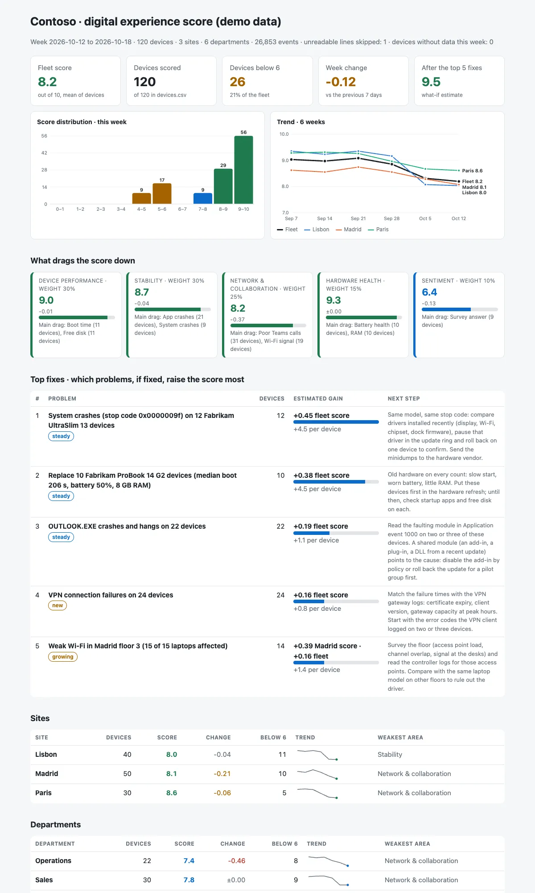

# DEX Experience Score

Turns **endpoint telemetry** (boot and logon times, app crashes and hangs, blue screens, Wi-Fi, latency, Teams call quality, VPN failures, battery and disk) into a **0–10 digital experience score** per device, per site and per department, shows what drags it down, tracks it week over week and answers one question for the service owner: **which five problems, if fixed, would raise the score most?**

Python 3.10+, standard library only. PowerShell collector. Runs with fictional demo data out of the box.



> **Learning in public.** This is a lab I built to learn how digital employee experience (DEX) scoring works. It is inspired by the public descriptions of DEX scores in tools like Nexthink, but it is not affiliated with, endorsed by or a replacement for any product, and I have no hands-on experience with those products. The model, thresholds and weights are my own and are explained in [docs/scoring.md](docs/scoring.md).

## Why

Anyone who has supported Windows users on site knows the same pattern:

- **tickets show a fraction of the problems**: people work around a slow laptop or a crashing app for weeks before they call,
- after a few bad experiences, users **stop reporting** and just tell their colleagues "IT is slow",
- a monthly update or a new security agent makes **boot and logon slower** for everyone, a little, and nobody opens a ticket for 40 extra seconds,
- an **Outlook or Teams add-in update** crashes the app on twenty laptops, and each user thinks it is just them,
- the **Wi-Fi on one floor** is weak, so calls there are poor and laptops drop the connection, but only the loudest person reports it,
- **batteries** wear out and laptops die in meetings, long before anyone asks for a replacement,
- one **driver update** brings blue screens to a single laptop model.

Endpoint telemetry sees all of these. A score per device, rolled up by site and department, turns it into a short weekly list of what to fix first.

## How the score works

Each metric is mapped to 0–10 between a **good** and a **poor** threshold (boot ≤ 60 s scores 10, ≥ 180 s scores 0, linear in between; event counts are rates per active day). Metrics form five categories: **Device performance** (boot, logon, CPU and memory pressure, free disk), **Stability** (app crashes, hangs, system crashes), **Network & collaboration** (Wi-Fi signal and drops, latency, poor Teams calls, VPN failures), **Hardware health** (battery, RAM) and an optional **Sentiment** survey. The device score is the weighted mean of its categories, with two caps: a blue screen caps the device at 5, and a very poor category caps it at that category + 3. Missing data (no battery on a desktop) is left out, never scored as zero. Sites, departments and the fleet are the mean of their devices.

**Top fixes** are estimated by re-scoring the affected devices as if the problem were gone and ranking by fleet score gain (gain per device × devices affected).

Full model, thresholds, worked example and limits: [docs/scoring.md](docs/scoring.md). Input formats: [docs/telemetry-schema.md](docs/telemetry-schema.md).

Outputs:

- `report.html`: single file, light and dark mode, inline SVG charts (no JavaScript): fleet score, devices below 6, week change, the estimated score after the top 5 fixes, score distribution, 6-week trend by site, category breakdown with what drags each one, top fixes, sites and departments with sparklines, worst devices, VIP devices below 7, and score vs tickets.
- `device_scores.csv`: every device with its score, categories, change vs last week, cap applied, main issue and tickets.
- `top_fixes.csv`: the ranked problems with devices affected, estimated gain and next step.
- `review.md`: weekly review notes for the service owner (headline, top 5 fixes, what changed, sites and departments, VIPs, tickets, data quality).

## Try it

```bash
git clone https://github.com/inigogonzalezgarcia/22-dex-experience-score.git
cd 22-dex-experience-score
python -m dexscore demo
```

Open `output/report.html` and `output/review.md`.

The demo is a made-up company (Contoso) with 120 devices in Madrid, Lisbon and Paris, six departments and six weeks of telemetry, tickets and survey answers. Device names, users, the "Fabrikam" laptop models and every number are invented; the data is deterministic, so every run gives the same report. Problems are placed on purpose, and the demo finds them as the top 5 fixes:

1. blue screens (stop code 0x9F) on one laptop model after a driver update in week 5,
2. ten old laptops with slow boot and logon, 8 GB of RAM and worn batteries,
3. an Outlook add-in crash wave from week 4 on 22 laptops,
4. a spike of VPN failures for remote workers in the last two weeks,
5. weak Wi-Fi on Madrid floor 3.

Plus one VIP whose laptop is out of disk and memory, and one truncated line in the events file (skipped and counted).

## Use it with your own devices

1. Collect. On each device, as SYSTEM or a local administrator (an Intune remediation script or an RMM scheduled task):
   ```powershell
   .\scripts\Collect-DexTelemetry.ps1 -Days 7 -OutputFolder \\fileserver\dex$ -Site Madrid -Floor 3 -Department Finance
   ```
   Read-only. It reads boot times (Diagnostics-Performance 100), logon Group Policy time (GroupPolicy 8001), app crashes and hangs (Application 1000 / 1002), system crashes (BugCheck 1001, Kernel-Power 41), Wi-Fi drops (WLAN-AutoConfig 8003), built-in VPN failures (RasClient 20227), a Wi-Fi signal and latency sample, and a device row with model, RAM, free disk and battery health from `powercfg /batteryreport`. Options: `-LatencyHost`, `-Vip`, `-IncludeUser` (off by default), `-SampleMinutes` to sample CPU and memory pressure. It writes `<DEVICE>-events.jsonl` and `<DEVICE>-device.csv`. **It has not been run against a real fleet yet**; event fields can differ between Windows builds and languages.
2. Add, if you have them, a `tickets.csv` export from your ITSM tool and a `sentiment.csv` from a one-question survey (formats in [docs/telemetry-schema.md](docs/telemetry-schema.md)).
3. Build the outputs:
   ```bash
   python -m dexscore report collected/*-device.csv collected/*-events.jsonl tickets.csv sentiment.csv --out output
   ```
   Options: `--title "CONTOSO · weekly DEX review"`, `--now 2026-10-19` (score the weeks before that date), `--config dex.toml` (your own thresholds and weights, Python 3.11+; every key is in [docs/thresholds.example.toml](docs/thresholds.example.toml)).

**Privacy.** Device telemetry linked to a person is personal data under the GDPR. Collect the minimum you need (the collector leaves the user name out unless you ask for it), tell users what is collected and why, report by site and department rather than by person, and talk to your data protection officer and, where there is one, the works council before you start. Keep the telemetry and the reports inside your organisation. Real telemetry files in the repository root are excluded from Git by `.gitignore`.

## Tests

```bash
python -m unittest discover tests      # or: pip install -r requirements-dev.txt && python -m pytest
```

15 tests: metric mapping (good, poor, linear, inverted metrics), rates per active day and metrics nobody collects, category weighting and the very-poor-category cap, the system crash cap, desktops without a battery (category ignored, not zero), optional sentiment that never caps a device, devices with no data this week, site and department roll-ups, week windows and the trend, top-fix ranking and the combined estimate, ticket correlation and the VIP list, JSONL with bad lines skipped and counted (and .NET timestamps with seven decimals), CSV with a BOM and file-type detection, TOML overrides (skipped on Python 3.10), and the demo end to end (all five planted problems in the top 5, outputs written, no JavaScript in the report). Checked on Python 3.10 to 3.13.

**What has not been tested yet:**

- the collector against real devices. Field names (`BootTime`, `PolicyElaspedTimeInSeconds`, `BugcheckCode`), the English-only `netsh` parsing and the battery report XML are written from documentation, not from a fleet,
- the thresholds against real data. They are reasonable starting points, not benchmarks; a real fleet will need tuning after a few weeks,
- data from Intune Endpoint Analytics or an RMM tool, which would need a small mapping step to the event types,
- large fleets: everything is in memory, fine for thousands of devices, not designed for hundreds of thousands of events per day.

## Background

I have spent years supporting Windows end users and executives on site, working ITSM tickets, automating the repetitive parts with PowerShell, supporting Microsoft Teams and Teams Rooms, and I led a Windows 11 migration. The questions this lab plays with are the ones that work raises: which problems never reach the service desk, and which fix would help the most people. Written from scratch with fictional data; no employer scripts, data or configuration are used.

## Customisation and contact

Want this adapted to your environment (your own thresholds and weights, data from Intune Endpoint Analytics or your RMM, a Power BI view, alerts to Teams)? Get in touch:

- Website (contact form): [inigogonzalezgarcia.github.io](https://inigogonzalezgarcia.github.io/about.html#contacto)
- LinkedIn: [linkedin.com/in/igonzalez93](https://www.linkedin.com/in/igonzalez93)

## License

MIT
